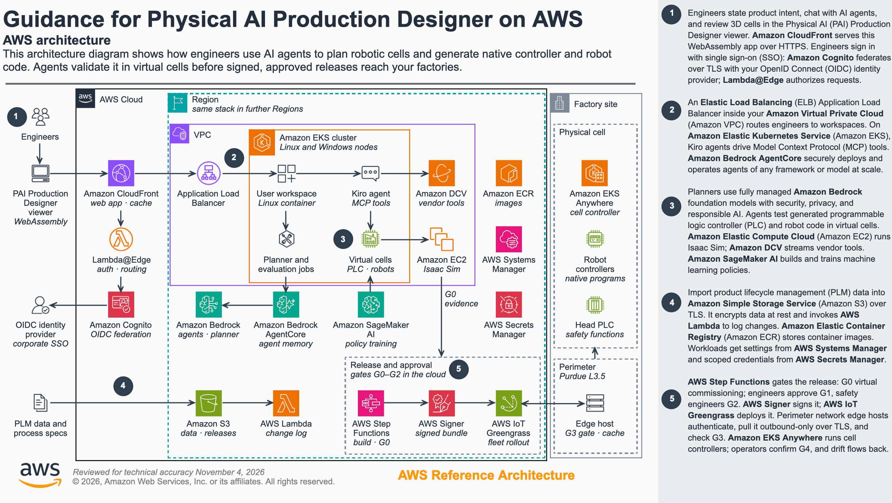
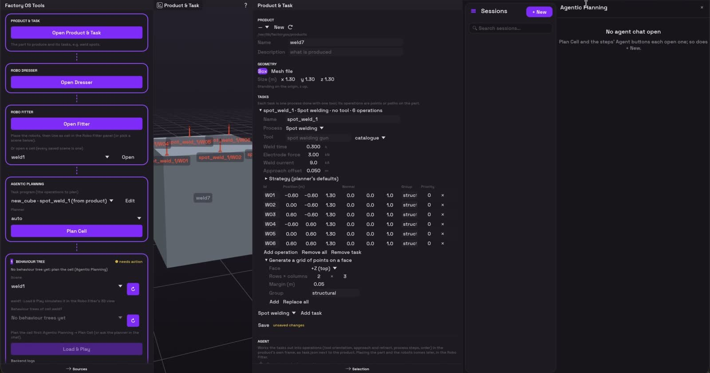
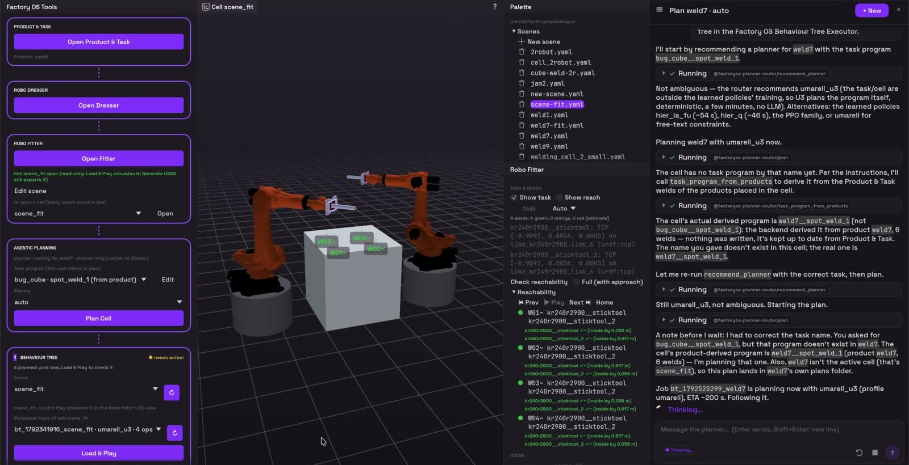

# Guidance for Physical AI Production Designer on AWS

## Table of Contents

1. [Overview](#overview)
    - [Architecture](#architecture)
    - [Architecture details](#architecture-details)
    - [What the installer deploys](#what-the-installer-deploys)
    - [Cost](#cost)
2. [Prerequisites](#prerequisites)
    - [Operating System](#operating-system)
3. [Deployment Steps](#deployment-steps)
    - [Option A: the CloudFormation installer](#option-a-the-cloudformation-installer)
    - [Option B: install from a shell](#option-b-install-from-a-shell)
4. [Deployment Validation](#deployment-validation)
5. [Running the Guidance](#running-the-guidance)
6. [Next Steps](#next-steps)
7. [Cleanup](#cleanup)
8. [FAQ, known issues, additional considerations, and limitations](#faq-known-issues-additional-considerations-and-limitations)
9. [Revisions](#revisions)
10. [Notices](#notices)
11. [Authors](#authors)

## Overview

Programming a new robot cell still passes through a separate tool and a hand-off for every step: the product data,
the robots and their tools, the cell layout, the motion plan, the interlocks, and the PLC and robot programs. Each
new product variant starts much of that work again. This Guidance shows how to bring these steps into one
browser-based application on AWS, Physical AI Production Designer (FactoryOS in the code), which an AI agent can
drive through MCP tools and whose output is deterministic, checked control code:

1. **Robo Dresser** mounts a tool on a robot (URDF and meshes) and computes the dressed robot's collision hulls.
2. **Robo Fitter** lays the dressed robots, fixtures and a floor plan out into a cell, and checks which robot reaches
   which weld.
3. **Product & Task** holds the product to weld and the welding task on it.
4. **Planning** assigns the welds to the robots and plans every motion: learned policies (hierarchical reinforcement
   learning and PPO, the checkpoints included) and a scripted generator for the reference cell they were trained on;
   umarell's planning tools (OMPL) driven by a deterministic parallel orchestrator (U3) for any cell; optionally an
   agentic planner that takes constraints in plain words (with models on Amazon Bedrock). In the viewer, a Kiro CLI
   agent runs the planners from its chat through the planner router's MCP tools. Every plan becomes a behaviour tree
   and is checked before it is offered: joint and speed limits, robot-robot and robot-environment collisions, and the
   timing of every motion.
5. **Behaviour tree executor** runs the plan on the simulated cell (Pinocchio kinematics, Coal collision checks) in
   the 3D view.
6. **Control code**: plan2cell generates the head PLC's program (IEC 61131-3 Structured Text, for CODESYS) and the
   robots' KUKA KRL programs from the plan.

The sample data is a reference welding cell, `welding_cell_2_small`: two KUKA KR 240 R2900 robots with stick welding
tools and 15 spot welds.

### Architecture

The diagrams below are the Guidance's reference architecture: the overview, and four views that zoom into its parts.
This Guidance's installer deploys a subset of it, on one instance; [What the installer
deploys](#what-the-installer-deploys) lists which parts.



1. Engineers state product intent, chat with AI agents, and review 3D cells in the Physical AI (PAI) Production
   Designer viewer. Amazon CloudFront serves this WebAssembly app over HTTPS. Engineers sign in with single sign-on
   (SSO): Amazon Cognito connects over TLS to your OpenID Connect (OIDC) identity provider, as a federated identity
   provider; Lambda@Edge authorizes requests.
2. An Elastic Load Balancing (ELB) Application Load Balancer inside your Amazon Virtual Private Cloud (Amazon VPC)
   routes engineers to workspaces. On Amazon Elastic Kubernetes Service (Amazon EKS), Kiro agents drive Model Context
   Protocol (MCP) tools. Amazon Bedrock AgentCore securely deploys and operates agents of any framework or model at
   scale.
3. Planners use fully managed Amazon Bedrock foundation models with security, privacy, and responsible AI. Agents test
   generated programmable logic controller (PLC) and robot code in virtual cells. Amazon Elastic Compute Cloud (Amazon
   EC2) runs Isaac Sim; Amazon DCV streams vendor tools. Amazon SageMaker AI builds and trains machine learning
   policies.
4. Import product lifecycle management (PLM) data into Amazon Simple Storage Service (Amazon S3) over TLS. It encrypts
   data at rest and invokes AWS Lambda to log changes. Amazon Elastic Container Registry (Amazon ECR) stores container
   images. Workloads get settings from AWS Systems Manager and scoped credentials from AWS Secrets Manager.
5. AWS Step Functions gates the release: G0 virtual commissioning; engineers approve G1, safety engineers G2. AWS
   Signer signs it; AWS IoT Greengrass deploys it. Perimeter network edge hosts authenticate, pull it outbound-only
   over TLS, and check G3. Amazon EKS Anywhere runs cell controllers; operators confirm G4, and drift flows back.

### Architecture details

**Experience and orchestration:** how engineers sign in, work in the viewer, and drive agents and planners in their
workspace, and how product data reaches AWS.


6. In the PAI Production Designer viewer, engineers review cells in 3D and use tool pages, terminals, agent chat, and
   behaviour-tree timelines. Amazon CloudFront, a content delivery network (CDN), serves the WebAssembly (WASM) app.
   Lambda@Edge authenticates single sign-on (SSO) requests; Amazon Cognito uses your OpenID Connect (OIDC) identity
   provider as a federated identity provider.
7. CloudFront carries three TLS streams: HTTPS, Zenoh, and Amazon DCV for human-machine interfaces (HMIs). An
   Application Load Balancer from Elastic Load Balancing in your Amazon Virtual Private Cloud (Amazon VPC) routes them
   to user workspaces. Each least-privilege Linux container on Amazon Elastic Kubernetes Service (Amazon EKS) hosts a
   backend API.
8. Engineers and the Kiro agent drive modules over Model Context Protocol (MCP), and plan2cell generates programmable
   logic controller (PLC) and robot programs. The planner router calls the multi robot agentic solver, a large
   language model (LLM) planner. Fully managed Amazon Bedrock provides foundation models with security, privacy, and
   responsible AI.
9. Zenoh, a low-latency peer-to-peer data plane, links the viewer, workspaces, virtual cells, and Isaac Sim with
   publish/subscribe and queries. It carries scene deltas, joint states at controller rate, PLC signals, behaviour-tree
   events, controller commands, and live controller data. Viewer, agents, and cells share one live state.
10. Amazon Bedrock AgentCore keeps agent memory and securely deploys and operates agents of any framework or model at
    scale. Amazon Simple Storage Service (Amazon S3) hosts viewer builds and stores product lifecycle management (PLM)
    bills of materials (BOMs) and specs, encrypted at rest. AWS Lambda logs catalogue changes.

**Virtual cells and simulation:** how virtual controllers on a fieldbus, vendor tools, and physics simulation run and
debug your code, and how trained policies reach the cell.


11. Every engineer and agent gets a disposable virtual cell from Git. A Zenoh mesh links it to your user workspace,
    which deploys generated robot and programmable logic controller (PLC) code. Closed-loop tests inject faults.
    Failures return to the agent; engineers get passing code as a pull request with test evidence.
12. Cells run on Amazon Elastic Kubernetes Service (Amazon EKS) nodes. The cell runtime runs policy inference and
    steers virtual robot controllers. PROFINET or another fieldbus carries cyclic I/O to sensors, the HMI, and an
    International Electrotechnical Commission (IEC) 61131-3 virtual PLC. Generated code runs unchanged, as on the shop
    floor.
13. PLC and robot vendor integrated development environments (IDEs) run on a Windows Amazon Elastic Compute Cloud
    (Amazon EC2) host. Amazon DCV streams them over TLS for online debugging in the viewer. NVIDIA Isaac Sim on a
    graphics processing unit (GPU) host reruns the code; its physics can contradict the plan.
14. Fully managed Amazon SageMaker AI builds, trains, and evaluates machine learning policies for the cell runtime.
    Least-privilege containers pull images from Amazon Elastic Container Registry (Amazon ECR), settings from AWS
    Systems Manager, and credentials from AWS Secrets Manager. Amazon Simple Storage Service (Amazon S3) encrypts
    backups at rest.

**On-premises deployment:** how approved cell releases move from AWS to your factory sites. Sites pull signed bundles
through approval gates, deploy them to the cell, and report drift back.


15. Engineers upload programmable logic controller (PLC) and robot projects to versioned Amazon Simple Storage Service
    (Amazon S3) buckets. Uploads start releases in AWS Step Functions, the single gatekeeper. AWS CodeBuild builds
    code, images, and software bills of materials. At G0, virtual controllers run unchanged code, checking cycle times
    and collisions.
16. Humans gate the boundary, not the sandbox. Controls or robot engineers approve G1; for safety changes, a safety
    engineer and change board approve G2 through Step Functions task tokens. AWS Signer signs bundles with approval
    attestations. Amazon S3 Object Lock and Amazon Elastic Container Registry (Amazon ECR) store them encrypted.
17. AWS IoT Greengrass rolls releases out in waves. AWS IoT Core runs jobs; Amazon DynamoDB and Amazon S3 Object Lock
    store approvals, simulation evidence, and device status. The edge host in the plant perimeter network, an
    International Electrotechnical Commission (IEC) 62443 zone, pulls deployments over TLS; the cloud never pushes.
18. The release agent verifies signatures and attestations and checks G3: a maintenance window, safe cell, backup, and
    no active manufacturing execution system (MES) order. It deploys head PLC, cell controller, and HMI containers to
    Amazon EKS Anywhere; the Windows edge host loads the safety PLC and robot controllers.
19. In the cell network, a fieldbus links PLCs, robots, and the HMI. Only adapters cross one restricted conduit into
    it. Each adapter backs up, checks drift, deploys, reads back, verifies, and reports; rollback restores its backup.
20. At G4, the operator confirms a reduced-speed cycle on the teach pendant; motion never starts remotely. The Zenoh
    bridge streams drift over TLS to the PAI Production Designer twin on Amazon Elastic Kubernetes Service (Amazon
    EKS). Operational technology (OT) asset management keeps device versions.

**User workspace:** one engineer's user workspace: the backend, the agent stack, and the cell bridges, and how they
reach virtual cells, vendor tools, and AWS services.


21. Engineers chat with the AI agent and approve cells in 3D in the Physical AI (PAI) Production Designer viewer.
    Lambda@Edge on Amazon CloudFront checks the OpenID Connect (OIDC) login. An Application Load Balancer from Elastic
    Load Balancing (ELB) terminates HTTPS for least-privilege containers on Amazon Elastic Kubernetes Service (Amazon
    EKS).
22. The backend, the only entry point, proxies Zenoh, desktop, WebRTC, and teach-pendant sessions. Cell tools deploy
    programmable logic controller (PLC) and robot code and solve inverse kinematics (IK). The Kiro agent uses its Kiro
    service chat model, speaks Agent Client Protocol (ACP), and drives modules through Model Context Protocol (MCP).
23. The MCP planner router starts planner jobs that compare robot counts, placements, and task orders. Burst jobs add
    Amazon Elastic Compute Cloud (Amazon EC2) instances. The multi robot agentic solver, a large language model (LLM)
    planner, invokes foundation models on Amazon Bedrock, a fully managed service with security and privacy.
24. The live bridge reads the head PLC over OPC UA and virtual robot controllers over Zenoh, read-only, and publishes
    the live scene. A proxy relays Amazon DCV from the Windows integrated development environment (IDE) host. Cell
    tools deploy through its PLC IDE MCP bridge with an AWS Secrets Manager token.
25. The Isaac bridge links NVIDIA Isaac Sim on graphics processing unit (GPU) hosts to Zenoh, outbound over secure
    WebSocket. Workspaces install the release named in Parameter Store in AWS Systems Manager. Amazon Simple Storage
    Service (Amazon S3) holds releases, user data, and backups, encrypted at rest. AWS Lambda controls cells.

### What the installer deploys

The installer (`deployment/install.sh`) deploys the user workspace of the reference architecture, shared by the
deployment's users, on one Amazon EC2 instance, with the AWS CDK app in `deployment/`. It creates two AWS
CloudFormation stacks: `factoryos` in the Region you choose, and `factoryos-edge` in US East (N. Virginia), where
CloudFront's Lambda@Edge function lives. The virtual cells, the simulation hosts, the policy training and the
on-premises release pipeline are not part of it.

| In the reference architecture (steps) | In this Guidance's deployment |
| --- | --- |
| Amazon CloudFront serves the viewer; Lambda@Edge authorizes every request (1, 6, 21) | The same. The Lambda@Edge function checks the Amazon Cognito tokens on every request, including WebSocket upgrades, before CloudFront forwards it. |
| Amazon Cognito with your OIDC identity provider, federated (1, 6) | The `factoryos` stack's own Amazon Cognito user pool, in the Region of the deployment: managed login, multi-factor authentication required, users created by the deployer, no self sign-up and no federation. |
| An Application Load Balancer in the VPC routes engineers to their user workspaces on Amazon EKS (2, 7, 21) | No load balancer and no Amazon EKS: CloudFront reaches one AWS Graviton Amazon EC2 instance (m7g.2xlarge, Ubuntu 24.04) in a private subnet of the stack's VPC through a VPC origin on port 80. The instance has no public IP address and reaches the internet only outbound, through a NAT gateway, for the build dependencies and the Kiro service. |
| The user workspace: backend API, workflow modules, Kiro agent, planner router, agentic solver and planner jobs (8, 22, 23) | One workspace on the instance, shared by every user: the backend with the web viewer, the Robo Dresser, Robo Fitter and Product & Task, the cell runtime, the Kiro agent, the planner router and planners, and plan2cell. Its Amazon EBS volume holds the designs, cells and plans. The planners run on the instance; there are no burst jobs. |
| Amazon Bedrock (3, 8, 23) | Optional: the agentic planner invokes Anthropic models on Amazon Bedrock when you install with `--bedrock` or `--bedrock-models`. |
| Amazon S3 holds releases and data (4, 10, 25) | An Amazon S3 bucket holds the release sources the instance builds from, and a second one the access logs of that bucket and of CloudFront. |
| AWS Systems Manager (4, 25) | The only administrative access (Session Manager, no SSH). Run Command starts release builds, and Parameter Store keeps the release state. |
| AWS Secrets Manager (4, 14, 24) | Optional: the instance reads a Kiro API key from a secret you name (`--kiro-secret`). |
| Virtual cells, the Windows IDE host with Amazon DCV, NVIDIA Isaac Sim, Amazon SageMaker AI, Amazon ECR, Amazon Bedrock AgentCore and the Lambda change log (3, 9 to 14, 24, 25) | Not deployed. Plans run on the simulated cell in the viewer (Pinocchio kinematics, Coal collision checks), and the learned policies' checkpoints are included. |
| The release pipeline, the approval gates and the factory site (5, 15 to 20) | Not deployed. plan2cell's PLC and robot programs are downloaded from the viewer. |

Besides, Amazon CloudWatch collects the instance's bootstrap and release (build) logs, the VPC flow logs and the
Lambda logs, and the deployer runs `deployment/install.sh` from AWS CloudShell or a workstation: it deploys the AWS
CDK app, which creates the AWS CloudFormation stacks, and starts the release build on the instance.

### Cost

_You are responsible for the cost of the AWS services used while running this Guidance. As of November 2026, the cost
for running this Guidance with the default settings in the US East (N. Virginia) Region is approximately $301.32 per
month for running one deployment around the clock for a team of up to 10 users._

_We recommend creating a [Budget](https://docs.aws.amazon.com/cost-management/latest/userguide/budgets-managing-costs.html)
through [AWS Cost Explorer](https://aws.amazon.com/aws-cost-management/aws-cost-explorer/) to help manage costs. Prices
are subject to change. For full details, refer to the pricing webpage for each AWS service used in this Guidance._

The Amazon EC2 instance is most of the cost, and it is billed for every hour it runs, whether or not anyone uses it.
Stopping it outside working hours (for example, running it 200 hours a month) lowers its share from $238.27 to about
$65.28; the EBS volume and the NAT gateway are billed while it is stopped. Do not stop it while a release builds
(`./deployment/install.sh status` shows the release phase). `install.sh uninstall` removes every billed resource the
Guidance created ([Cleanup](#cleanup)); the AWS CDK bootstrap stacks (`CDKToolkit`, with an S3 staging bucket) that the
installer creates where they are missing, in your Region and in us-east-1, stay and cost a few cents a month.

The table prices every line at the On-Demand list price without the AWS Free Tier, as the AWS Pricing Calculator
does, except Amazon Cognito's 10,000 free monthly active users, which the calculator subtracts too. On a real bill,
the always-free tiers of Amazon CloudFront (1 TB of data transfer out to the internet and 10,000,000 requests per
month: all of its line except the $0.20 to the origin) and the 100 GB of data transfer out to the internet per month
usually apply as well, so you pay about $295 a month instead of $301.32. Lambda@Edge has no free tier. Outside
us-east-1 its log groups have no retention period: their storage grows by about $0.015 a month until you uninstall.

### Sample Cost Table

The following table provides a sample cost breakdown for deploying this Guidance with the default parameters in the
US East (N. Virginia) Region for one month. The prices are the public On-Demand list prices of that Region.

| AWS service  | Dimensions | Cost [USD] |
| ----------- | ------------ | ------------ |
| Amazon EC2 | 1 m7g.2xlarge On-Demand Linux instance (8 vCPU, 32 GiB), 730 hours a month | $ 238.27 |
| Amazon EBS | 200 GB gp3 volume (3,000 IOPS and 125 MB/s included) | $ 16.00 |
| Amazon VPC: NAT gateway | 1 NAT gateway, 730 hours, 50 GB of data processed (build dependencies) | $ 35.10 |
| Amazon VPC: public IPv4 address | 1 address of the NAT gateway, 730 hours | $ 3.65 |
| Amazon CloudFront | 50 GB data transfer out to the internet, 1,000,000 HTTPS requests, and 10 GB of data transfer out to the origin (uploads and client-to-server WebSocket frames) per month | $ 5.45 |
| AWS Lambda@Edge | 1,000,000 viewer-request invocations per month, 128 MB, 5 ms each | $ 0.63 |
| Amazon Cognito | 10 monthly active users (Essentials feature plan), TOTP MFA; within the 10,000 free monthly active users | $ 0.00 |
| Amazon S3 | 2 GB Standard storage of release sources and access logs, about 22,000 requests | $ 0.06 |
| Amazon CloudWatch | 2.5 GB of logs ingested per month (the instance's bootstrap and release logs, VPC flow logs as vended logs, and the Lambda@Edge function's logs), kept for a month (stored compressed, about 0.4 GB) | $ 1.26 |
| Amazon EC2: data transfer out | 10 GB to the internet through the NAT gateway | $ 0.90 |
| AWS Systems Manager | Session Manager, Run Command and standard Parameter Store parameters | $ 0.00 |
| AWS Lambda | the stacks' custom resources and the gate check, a few invocations per deployment | $ 0.00 |
| AWS KMS | the AWS managed key `aws/ebs` that encrypts the volume | $ 0.00 |
| AWS CloudFormation | the two stacks, which use AWS resource types only | $ 0.00 |
| **Total** | | **$ 301.32** |
| Amazon Bedrock (optional, not in the total) | Agentic planner: for example 20 planning sessions with 200,000 input and 20,000 output tokens each on Anthropic Claude Sonnet 5 at $2.20 and $11.00 per million tokens, the US geographic cross-Region inference price the deployment's `us.` inference profiles pay (on Claude Opus 5, at $5.50 and $27.50, the same sessions cost $33.00) | $ 13.20 |
| AWS Secrets Manager (optional, not in the total) | 1 secret with a Kiro API key (`--kiro-secret`) | $ 0.40 |

## Prerequisites

### Operating System

You run the installer, `deployment/install.sh`, from **AWS CloudShell** (recommended: it has every tool below and the
credentials of your console session) or from a **Linux or macOS** workstation with a bash shell. On Windows, use
AWS CloudShell or the Windows Subsystem for Linux.

The installer creates the instance it builds and runs the Guidance on: Ubuntu 24.04 LTS (arm64) on an AWS Graviton
m7g.2xlarge with a 200 GB gp3 volume. You do not launch or prepare a host yourself.

### Third-party tools

On the machine you install from (AWS CloudShell has all of them):

- the [AWS CLI v2](https://docs.aws.amazon.com/cli/latest/userguide/getting-started-install.html), with credentials for
  the account (see [AWS account requirements](#aws-account-requirements));
- [Node.js](https://nodejs.org) 20 or newer, with npm. The installer runs the AWS CDK CLI version that
  `deployment/package-lock.json` pins (`npm ci`, `npx cdk`), never a globally installed one;
- git, python3, bash, tar, unzip and curl.

On the instance, the release build fetches the Rust crates, npm packages, Python packages and Rerun 0.38.1 from
crates.io, the npm registry, PyPI and GitHub, each at the version its lock file or pin names. Their licences are listed
in [THIRD-PARTY-NOTICES.md](THIRD-PARTY-NOTICES.md). Two more come from their own publishers:

- **umarell** (the U3 and agentic planners): fetched from GitHub at the commit pinned in `source/deploy/umarell.pin`.
  That repository is not public yet; until it is, an installation needs `--umarell-tarball` ([Known
  issues](#known-issues)).
- **Kiro CLI** 2.26.1 (the planning agent): installed on the instance and checked against its sha256. It needs a Kiro
  subscription and is subject to Kiro's terms ([kiro.dev](https://kiro.dev)). Review them before you sign the agent
  in. The viewer plans through this agent's chat for every planner, so planning in the viewer needs it signed in;
  only the agentic planner also needs Amazon Bedrock.

### AWS account requirements

- An AWS account, and credentials that may deploy AWS CDK apps and create IAM roles. An administrator role in the
  account covers everything the installer does. For a narrower role, see the [permissions the installer
  needs](docs/operations.md#permissions-the-installer-needs) in the operations guide.
- The m7g.2xlarge instance needs 8 vCPUs of the Amazon EC2 quota described in [Service limits](#service-limits).
- Optional, for the agentic planner: access to Anthropic models on Amazon Bedrock in the Region of the deployment
  (first-time use of Anthropic models may require submitting use case details in the Amazon Bedrock console). The
  instance may call Bedrock only when you install with `--bedrock` (the cross-Region inference profiles of the models
  the agentic planner uses) or `--bedrock-models <id,...>` (the inference profile ids you name), and then only those
  inference profiles and the models they route to.
- Optional: a Kiro API key in an AWS Secrets Manager secret of the same Region (`--kiro-secret <secret name>`), if your
  Kiro subscription uses one. Otherwise users sign the agent in from the viewer ([Deployment
  Steps](#deployment-steps), step 6).

### aws cdk bootstrap

The Guidance uses the AWS CDK. The AWS CDK has to be bootstrapped once per account in the Region of the deployment and
in US East (N. Virginia) (`us-east-1`), where the stack of the Lambda@Edge function goes. `install.sh install` checks
both and runs `cdk bootstrap` only where the bootstrap is missing, so you need not do it yourself. To bootstrap
yourself, with the CDK CLI the Guidance pins, run this from the repository's root, and once more with your Region in
place of `us-east-1` if you deploy to another Region ([details](docs/operations.md#bootstrap-the-aws-cdk-yourself)):

```sh
(cd deployment && npm ci) && deployment/node_modules/.bin/cdk bootstrap aws://<account-id>/us-east-1
```

### Service limits

The m7g.2xlarge instance needs 8 vCPUs of the **Running On-Demand Standard (A, C, D, H, I, M, R, T, Z) instances**
quota of Amazon EC2 in the Region. The deployment also creates one VPC, one NAT gateway with one Elastic IP address,
one CloudFront distribution and one Cognito user pool. Check the quotas, and request an increase if needed, on the
[Service Quotas console](https://console.aws.amazon.com/servicequotas/).

Cognito's default e-mail sender sends at most about 50 invitations a day; for more users, configure Amazon SES for the
user pool ([Manage users](docs/operations.md#manage-users)).

### Supported Regions

The default and tested Region is US East (N. Virginia) (`us-east-1`). The Guidance works in any commercial Region that
offers AWS Graviton m7g instances, CloudFront VPC origins and Cognito managed login; the edge stack is always in
us-east-1. The agentic planner additionally needs Anthropic models on Amazon Bedrock in the Region of the deployment.
One stack name serves one Region: to install a second deployment in another Region, give it another name
(`--stack-name`).

## Deployment Steps

There are two ways to install, and both run the same installer, `deployment/install.sh`:

- **Option A** is one AWS CloudFormation stack. It needs no shell and no tools, and it waits for the installation
  for you.
- **Option B** runs the installer from AWS CloudShell or your workstation. It gives you every option of the
  installer, such as several users or a custom Amazon Bedrock model list.

### Option A: the CloudFormation installer

The template `deployment/pai-pd-installer.yaml` creates an AWS CodeBuild project and starts it. The project gets
this Guidance, runs `deployment/deploy.sh`, which runs `deployment/install.sh` without prompts, and reports the
result to the stack. The stack completes once Physical AI Production Designer is ready, which takes about 2.5 to 3
hours. The CodeBuild project's role has `AdministratorAccess`, because the installer bootstraps the AWS CDK and
creates IAM roles, Amazon CloudFront and Lambda@Edge. Only CodeBuild can assume the role, and only for this
stack's project.

1. Open AWS CloudShell in the Region of the deployment, and clone the repository:
   ```sh
   git clone https://github.com/aws-solutions-library-samples/guidance-for-physical-ai-production-designer-on-aws
   ```
2. Create the installer stack. Replace `you@example.com` with the e-mail address of the first user: Amazon Cognito
   sends the sign-in URL and a temporary password to it. `--on-failure DO_NOTHING` keeps a failed stack, with its
   build log and its `Uninstall` command, instead of rolling it back.
   ```sh
   aws cloudformation create-stack --stack-name pai-pd-installer \
     --template-body file://guidance-for-physical-ai-production-designer-on-aws/deployment/pai-pd-installer.yaml \
     --capabilities CAPABILITY_IAM --on-failure DO_NOTHING \
     --parameters ParameterKey=AdminEmail,ParameterValue=you@example.com
   ```
   To install a specific release instead of the latest one, add `ParameterKey=Release,ParameterValue=<tag>`.

   **In the console instead:**
   1. Download `deployment/pai-pd-installer.yaml`.
   2. In the [AWS CloudFormation console](https://console.aws.amazon.com/cloudformation/home), choose
      **Create stack**, then **With new resources (standard)**, then **Upload a template file**.
   3. Enter **Administrator e-mail**.
   4. Under **Stack failure options**, choose **Preserve successfully provisioned resources**.
   5. Acknowledge that the stack creates IAM resources, then choose **Submit**.
3. Follow the installation. The stack's `BuildLogs` output links to the build:
   ```sh
   aws cloudformation describe-stacks --stack-name pai-pd-installer --query 'Stacks[0].[StackStatus,Outputs]'
   ```

The invitation e-mail arrives once the infrastructure is deployed, after about 40 minutes. Until the release build
on the instance is finished, the URL signs you in and then shows an error page. Watch the build with the stack's
`BuildLogs` output. When the stack is `CREATE_COMPLETE`, its `Url` output is the application.

To install another release later, update the stack with a new **Release**. The update starts a new build, which
updates the installation in place. The stack update completes at once; follow the build in `BuildLogs`.

**Installing from your own files.** The template can also install from files you provide instead of GitHub:

- **Source `upload`**: the stack creates a private bucket and completes in about a minute. Upload the files to it
  (the `UploadTo` output), then start the installation (the `StartInstall` output).
- **Source `s3`**: set **Artifact set** to an `s3://bucket/prefix/` that holds the files.
- **Any source**: set **Export archive** or **umarell archive** to an `s3://` or `https://` URI, for example a
  presigned URL. Presigned URLs only need to be valid when the build starts, which downloads them first. A presigned
  URL in a parameter can be read by anyone allowed to describe the stack until it expires, so keep its expiry short.

`deployment/make-artifacts.sh <export.zip> --umarell <umarell.tar.gz> --out <dir or s3://...>` writes such a set:
the export, the umarell archive, a `.sha256` file for each, and an `artifacts.json` that names them. The build
checks every `.sha256` file before it installs anything.

### Option B: install from a shell

Run these steps in AWS CloudShell, or in a shell on your workstation with credentials for the account. A first
installation deploys the infrastructure in about 15 to 25 minutes; the instance then builds the release from source,
which takes a few hours ([Known issues](#known-issues)).

1. Clone the repository:
   ```sh
   git clone https://github.com/aws-solutions-library-samples/guidance-for-physical-ai-production-designer-on-aws
   ```
2. Change to the repository's root:
   ```sh
   cd guidance-for-physical-ai-production-designer-on-aws
   ```
3. Choose the Region of the deployment:
   ```sh
   export AWS_REGION=us-east-1
   ```
4. Install. Replace `you@example.com` with the e-mail address of the first user (a comma-separated list for several).
   The installer prints the account, the Region and the stack name and asks before it goes on; it bootstraps the AWS
   CDK where needed, deploys both stacks, checks that the sign-in denies anonymous requests (the `GateVerified`
   output), uploads the checkout to the stack's source bucket, starts the release build on the instance, and invites
   the users:
   ```sh
   ./deployment/install.sh install --from-checkout --region us-east-1 --users you@example.com
   ```
   Until the umarell repository is public, add `--umarell-tarball s3://<bucket>/umarell.tar.gz` ([Known
   issues](#known-issues); how to make the tarball: [Provide umarell as a
   tarball](docs/operations.md#provide-umarell-as-a-tarball)). Without it, the release build fails when it installs
   the planners.
5. Follow the release build until it is `ready`. The command polls every minute and prints only changes; if your
   CloudShell session ends, run it again, the build goes on without it:
   ```sh
   ./deployment/install.sh status --wait
   ```
6. Sign in. Each user gets an e-mail from Cognito with the URL, their user name and a temporary password (valid for
   7 days).
   1. Open the URL, sign in with the e-mail address and the temporary password, and choose a new password.
   2. Enrol multi-factor authentication: scan the QR code with an authenticator app (TOTP) and enter its code. Every
      later sign-in asks for a code.
   3. Unless you installed with `--kiro-secret`, sign the Kiro agent in (the viewer plans through its chat, for every
      planner): in the viewer's settings, choose
      how (a personal AWS Builder ID, or your organisation's IAM Identity Center start URL and Region), choose **Sign
      in to the agent**, and approve the request on the page that opens. The agent's sign-in is shared by every user
      of the deployment.

The [operations guide](docs/operations.md) has the installer's other tasks: [adding and removing
users](docs/operations.md#manage-users) (`add-user`, `remove-user`), [installing from a release
zip](docs/operations.md#install-from-a-release-zip), [updating an installation](docs/operations.md#update-an-installation)
in place, [every option](docs/operations.md#installer-commands-and-options) (such as `--stack-name`,
`--instance-type`, `--bedrock` and `--kiro-secret`), and the [installation without
input](docs/operations.md#install-without-input) (`deployment/deploy.sh`) for automated validation.

## Deployment Validation

1. Check the stack's outputs. `GateVerified` is `true` (the sign-in was checked to deny anonymous requests before the
   instance was opened to CloudFront), and `Url` is the Guidance's address:
   ```sh
   aws cloudformation describe-stacks --stack-name factoryos --query "Stacks[0].Outputs"
   ```
   The outputs also name the instance (`InstanceId`), the user pool (`UserPoolId`), the source bucket (`SourceBucket`)
   and the log group (`LogGroup`).
2. Check the release: `Release` shows `ready` and the version, and `Users` lists the invited users:
   ```sh
   ./deployment/install.sh status
   ```
3. Check that an anonymous request is denied. With the `Url` output in `URL`, the first command prints `401` and the
   second `302` (a redirect to the Cognito sign-in):
   ```sh
   URL=$(aws cloudformation describe-stacks --stack-name factoryos \
     --query "Stacks[0].Outputs[?OutputKey=='Url'].OutputValue | [0]" --output text)
   curl -sS -o /dev/null -w '%{http_code}\n' "${URL%/}/api/v1/health"
   curl -sS -o /dev/null -w '%{http_code}\n' -H 'Accept: text/html' "${URL%/}/"
   ```
4. Open the URL in your browser and sign in ([Deployment Steps](#deployment-steps), step 6): the Physical AI Production
   Designer viewer loads.

If the release ends `failed`, `status` shows the error and the last lines of the build log; the previous release (if
any) keeps serving. Fix the cause and run step 4 of the Deployment Steps again (with `--force` for the same version).
Where the full log is, and other problems: [Troubleshooting](docs/operations.md#troubleshooting).

## Running the Guidance

**Inputs.** The sample data in `source/assets/`, which the release installs on the instance: the reference cell
`welding_cell_2_small` (two KUKA KR 240 R2900 robots with stick welding tools, 15 spot welds), the catalogue it is
built from (the robot `kr240r2900`, the tool `sticktool`, the dressed robot `kr240r2900__sticktool`, the fixtures
`weld_fixture_box`, `weld_cube` and the sample cell's `car_door_fixture`, the products `weld_box` and `weld_cube_urdf`, scenes and a floor plan), and the
planners' checkpoints for that cell.

**Before you start.** Sign in at the stack's URL. Planning runs through the planner agent's chat, so the Kiro agent
must be signed in first ([Deployment Steps](#deployment-steps), step 6; not needed with `--kiro-secret`); the learned
policies and U3 do not call Amazon Bedrock. The viewer shows the workflow as cards on the left, top to bottom, the 3D
view in the centre, and the open tool's panels on the right. The top bar's **Simple | Advanced** switch shows more settings in Advanced; Simple uses their defaults.
If a step fails, see [Troubleshooting](docs/operations.md#troubleshooting) in the operations guide.

### 1. Product & Task: the part and its welds

Choose **Open Product & Task**, and in the panel's **Catalogue** section choose `weld_box` (it is copied into your
products and opened). To make your own, choose **New**, set its geometry (a box or a mesh file), add a **Spot
welding** task, place its points (**Add operation**, or **Generate a grid of points on a face**) and choose **Save**. The planners never add weld points: they plan the ones a task defines.

\
*The Product & Task tool, shown with another, larger box product than `weld_box`: the panel and the task table look
the same.*

**Result:** the box in the 3D view with its six spot welds `W01` to `W06` on the top face, and the task `spot_weld_1`
with each weld's position and approach direction.

### 2. Robo Dresser: mount the tool on the robot

Choose **Open Dresser**, pick the robot `kr240r2900` and the tool `sticktool` in the **Catalogue** panel, and choose
**Dress**. **Collision hulls** shows the hulls the collision checks use.

**Result:** "new URDF written", with the path `urdf-dressed-robots/kr240r2900__sticktool/kr240r2900__sticktool.urdf`,
and **Diagnostics** reports no issues: the tool sits on the flange, and the tool centre point (TCP) at its tip.

### 3. Robo Fitter: lay out the cell

In the **Robo Fitter** card, pick the cell `welding_cell_2_small` and choose **Open**. To lay out your own cell
instead: **Open Fitter**, **New scene**, place a product and two `kr240r2900__sticktool` robots from the **Palette**,
set each robot's position and home pose, turn on **Show task**, choose **Check reachability**, then **Save** the scene
and choose **Use as cell**.

**Result:** the two robots, the car-door fixture and the cell's weld points in the 3D view; the card says the cell is open (read-only).
The weld points sit 0.25 m above the fixture's panel, as in the umarell data the cell comes from: the fixture is an
obstacle the robots clear, not a part they touch, and the electrodes stop above the panel at every weld. In
your own scene, a weld turns green when at least one robot reaches it.

### 4. Agentic Planning: plan the motions

In the **Agentic Planning** card, pick the task program (in your own cell, `<product> · <task> (from product)`),
leave the planner on `auto`, and choose **Plan Cell**. The planner chat opens, and the agent calls the planner
router's tools: `recommend_planner` picks a planner (U3, for the sample cell too: the learned policies were trained on
a version of it without the fixture), `task_program_from_products` writes a task program where the cell has none, and `plan`
and `plan_status` plan and report progress. Advanced mode lets you pick the planner, for example `umarell_jam`, umarell's weld planner with a component cache
(its first job on a cell fills the cache and takes a few minutes, later ones take seconds). In the chat, you can ask for
another planner, or add a constraint in plain words, which the agentic planner handles (it calls Amazon Bedrock).

\
*The planner agent choosing a planner and planning a cell, shown on another cell than `welding_cell_2_small`, for
which the agent picks U3.*

**Result:** the agent's summary names the planner, the plan file, the cycle time and the checks the plan passed
(joint and speed limits, collisions, timing). U3 takes a few minutes.

### 5. Behaviour Tree: replay the plan

In the **Behaviour Tree** card, pick the scene and the behaviour tree, named `bt_<id>_<cell> · <planner> · <n> ops`,
and choose **Load & Play**.

\
*A plan replayed, shown on another cell than `welding_cell_2_small`: both robots welding, and the timeline of their
operations.*

**Result:** the robots weld in the simulated cell's 3D view. The card shows the progress with **Pause**, **Stop**
and **Loop**, and the timeline under the view shows each robot's operations, to step through and scrub. (**Watch in
Isaac Sim** stays off: this deployment has no Isaac Sim host.)

### 6. Control Code Export: the PLC and robot programs

In the **Generate PLC + robot code** card, pick the behaviour tree and choose **Export PLC + robot code**. Advanced
mode shows the options: **Profile** `Simulation`, **PLC dialect** `CODESYS V3.5`, **Robot language** `KUKA KRL`,
**OPC UA symbols** and **ST type check**. **Show the code** opens the build; **Download archive (.zip)** saves it.

\
*The export options, and the generated build's warnings and file tree.*

**Result:** the card reports the number of files and warnings; the build opens in place of the 3D view, with its
file tree, each file's code and the **Warnings** (**Back to the 3D view** closes it). The cards after this one (deploy
to a virtual cell, review in the PLC IDE, start production) need virtual controllers, which this deployment does not
include; they stay waiting.

### Expected output

A control code build holds:

- `BUILD.md`: the build's summary, with its `PLAN_ID`, the robots, the interlock zones with their ticket order, and
  the planned makespan;
- `plc/`: the head PLC's CODESYS project in IEC 61131-3 Structured Text (`plc/codesys/head/`, with the function blocks
  `POU/FB_Cell.st` and the zone arbiter `POU/FB_ZoneArbiter.st`), its robot simulators, `plc/project.json` and the
  interlock zones (`plc/ZONES.md`);
- `krl/robot1/`, `krl/robot2/`: each robot's KUKA KRL program, with its `INSTALL.md`;
- `plan2cell-build.json`: the same build as JSON.

`source/plan2cell/examples/welding_cell_2_small/` is the committed build of the sample plan
`source/plan2cell/test_data/bt_1790934549_welding_cell_2_small.json`: 2 robots, 2 interlock zones (`IL01`, `IL02`) and
a planned makespan of 64.297 s. The plan2cell tests check on every build that it is reproduced byte for byte.

### What the output means

The PLC program sequences the two robots through the plan's operations and grants the interlock zones in the planned
ticket order, so the robots never share a zone; the KRL programs are each robot's motions, with their handshakes to
the PLC. They are for the simulated reference cell ([Additional considerations](#additional-considerations)).

## Next Steps

- Add your own robots, tools, fixtures and products to the catalogue (URDF with meshes), dress them in the Robo
  Dresser, and lay out your own cells in the Robo Fitter.
- Plan your own cells with U3 or the agentic planner, and run the plans in the Behaviour Tree Executor.
- Explore the code generator's options (`plan2cell options`), and co-simulate a build's PLC program with the robots
  (`plan2cell simulate`, see `source/plan2cell/README.md`).
- Turn on the agentic planner's Amazon Bedrock access (`--bedrock` or `--bedrock-models <id,...>` on the next install
  command), and sign the agent in.
- Change the code in `source/`, commit it, and deploy it with the same install command ([Update an
  installation](docs/operations.md#update-an-installation)).
- Operate the deployment: users, updates, options, permissions and troubleshooting are in the [operations
  guide](docs/operations.md).
- Develop and test the deployment itself: [deployment/README.md](deployment/README.md).

## Cleanup

**If you installed with the CloudFormation installer (Option A):**

1. Run the installer stack's `Uninstall` command in AWS CloudShell. Alternatively, open the CodeBuild project from
   the `BuildLogs` output, choose **Start build with overrides**, and set the environment variable `ACTION` to
   `uninstall`. The build removes everything step 1 below lists. It also retries the edge stack for up to 2 hours
   while CloudFront removes the Lambda@Edge replicas.
2. When the build has succeeded, delete the installer stack. That removes the CodeBuild project, its role and log
   group, the helper function, and the inputs bucket with everything in it. Deleting the installer stack alone does
   **not** remove the application.

**If you installed from a shell (Option B):**

1. Uninstall. The installer lists what it deletes and asks you to type the stack name. It empties the stack's
   versioned source bucket, then deletes both stacks with everything in them, among them the instance and its volume
   (every design, cell and plan on it), the user pool and its users, and the CloudFront distribution, and the log
   groups Lambda created outside the stacks ([the full list](docs/operations.md#what-uninstall-deletes)). Add
   `--snapshot` to keep an EBS snapshot of the volume first.
   ```sh
   ./deployment/install.sh uninstall
   ```
2. If the edge stack (`factoryos-edge` in us-east-1) does not delete yet: CloudFront removes the Lambda@Edge
   function's replicas only some time after the distribution is gone. The installer says so; run this again after
   about 1 hour (it then also deletes the replicas' log groups):
   ```sh
   ./deployment/install.sh uninstall --edge-only
   ```
3. Delete what is not part of the stacks, if it applies: the EBS snapshot of `--snapshot`
   (`aws ec2 delete-snapshot --snapshot-id <snapshot id>`, the installer printed the id), log groups the uninstall
   warned it could not delete, and the release zip and the umarell tarball you uploaded to your own bucket
   ([what stays](docs/operations.md#what-stays)). The AWS CDK bootstrap stacks (`CDKToolkit`) stay: they belong to
   the account and are shared by every AWS CDK app in it.

**Without the installer.** The installation's stacks are an AWS CDK app, so the equivalent is `npx cdk destroy --all`
from `deployment/`, after the versioned source bucket is emptied. The app needs its context to synthesize, and the
installer's parameters are left to delete: [Without the installer](docs/operations.md#without-the-installer) has the
commands.

## FAQ, known issues, additional considerations, and limitations

For problems with the installation, the release build, users or the cleanup, see
[Troubleshooting](docs/operations.md#troubleshooting) in the operations guide.

### Known issues

- **umarell is not public yet.** The U3 and agentic planners need umarell at the commit pinned in
  `source/deploy/umarell.pin` (`08d5a39`), which the release build fetches from GitHub. Until that repository is
  public, the fetch fails and so does the release: install with `--umarell-tarball s3://<bucket>/umarell.tar.gz`
  ([Deployment Steps](#deployment-steps)).
- **The first release takes hours.** The instance builds everything from source: the Rust workspaces with link-time
  optimisation, Coal and Pinocchio, the web viewer and the planners' Python environment. Until the first release is
  `ready`, the URL signs you in and shows an error page. An update builds next to the running release, which keeps
  serving.
- **No AWS WAF.** The distribution has no web ACL: every request is authenticated at the edge (Cognito session, Lambda@Edge)
  before it reaches the instance, and the login pages are Cognito's managed login. The AWS CDK app acknowledges the
  cdk-nag rules `AwsSolutions-CFR2` (no WAF on the distribution) and `AwsSolutions-COG8` (the Cognito Essentials
  plan, without the Plus plan's threat protection) with these reasons. To add AWS WAF, associate a web ACL with the
  distribution and consider the Cognito Plus plan; both add cost.
- The pinned Kiro CLI build is arm64 only: the instance type has to be a Graviton type.
- Some third-party crates have published advisories that no release of the crate that depends on them fixes yet. They
  are tracked and will be removed when those crates update:
  - `lz4_flex` 0.10.0, RUSTSEC-2026-0041 (High), through zenoh 1.10.1. It is used only for zenoh's transport
    compression, which is off by default, and the Guidance does not turn it on.
  - `quick-xml` 0.36.2, 0.39.4 and 0.30.0, RUSTSEC-2026-0194 and RUSTSEC-2026-0195 (High), through Rerun's COLLADA
    mesh loader, `urdf-rs` and `behaviortree-rs`. The worst case is slow parsing of a crafted XML file that you open
    yourself; none of these crates uses the namespace reader that RUSTSEC-2026-0195 is about.
  - `rustls` 0.20.9, RUSTSEC-2024-0336 (High), in `source/plan2cell/`, through `trust-runtime` and `tiny_http`. Only
    `tiny_http`'s HTTPS server uses it, and plan2cell runs `trust-runtime` in process without starting a server.
  - `lru` 0.14.0 and 0.16.4, RUSTSEC-2026-0253 (no severity given), through zenoh 1.10.1. It needs cache keys or
    values whose own code panics; zenoh's keys are plain ids.

### Security: who can reach what

- **Anyone** can reach the CloudFront URL, and gets the Cognito sign-in page and nothing else: the Lambda@Edge
  function sends every request without a valid session to the sign-in (`302`), or answers it with `401`, before
  CloudFront forwards it. The installer creates users only after the stack verified that (`GateVerified`).
- **Every user of the user pool** shares the whole deployment: its designs, cells and plans, and its terminals. A
  terminal in the viewer is a shell on the instance as the service user `factoryos`, the user the backend runs as,
  with the permissions of the instance's IAM role through the instance metadata service: its own source bucket, its
  release parameters (including writing the release state that `status` shows), its log group, the Amazon Bedrock
  models you allowed and, with `--kiro-secret`, **reading the Kiro API key secret**. The terminals do not put the key
  in a shell's environment, but any user can read it with `aws secretsmanager get-secret-value`. Users also share the
  Kiro session and the Bedrock usage, which your account pays for. Invite only people you would give that access to,
  and the Kiro API key.
- **Administrators** reach the instance only through AWS Systems Manager Session Manager (no SSH, no public IP
  address), with IAM permissions for it in the account.
- The instance's security group accepts traffic only from CloudFront's VPC origins, on port 80, and only after the
  sign-in was verified. That rule admits every CloudFront distribution with a VPC origin for the instance, so the
  edge function also adds a secret header (the origin secret) to every request it lets through, and the backend
  refuses (`403`) any request from the network without it: a distribution without this deployment's edge function
  reaches nothing. The backend has no other authentication of its own: never open the instance to other traffic.
  The origin secret is not a boundary against the deployment's own users, whose terminals can read it;
  `install.sh install --rotate-origin-secret` replaces it ([Rotate the origin
  secret](docs/operations.md#rotate-the-origin-secret)).
- **The terminal also has the Systems Manager and CloudWatch agents' permissions, and they reach past this
  deployment.** The instance role carries what the two agents on the instance need, written out like the
  [`AmazonSSMManagedInstanceCore`](https://docs.aws.amazon.com/aws-managed-policy/latest/reference/AmazonSSMManagedInstanceCore.html)
  managed policy but without its Parameter Store reads. IAM cannot narrow these to the one instance, so they cover
  the whole account in the deployment's Region, and a terminal user has them too: they can read every Systems
  Manager document and association in that Region (your own documents included, with the scripts and parameters
  in them), report association status, compliance and inventory for any managed instance there (so another
  instance could be made to look patched or compliant in Systems Manager), and write metrics into the `CWAgent`
  namespace, also in the name of other instances. They cannot run commands on other instances, read Parameter
  Store, or read other instances' data. If the account or Region runs other workloads, install the Guidance into
  an account of its own.
- The session is Cognito's own tokens, in `__Host-` cookies (HttpOnly, Secure, SameSite=Lax): the ID and access
  tokens are valid for 60 minutes, and the edge function renews them with the refresh token (valid for 12 hours).
  Cognito replaces the refresh token at every renewal (refresh-token rotation), and the old one stops working a
  minute later.
- **Signing out does not end a copied session at once.** The edge function checks the tokens itself (signature,
  issuer, client, expiry) and does not ask Cognito on every request whether they were revoked. Signing out revokes
  the refresh token at Cognito and clears the cookies, but an ID and access token copied out of the browser before
  that stay accepted until they expire, at most 60 minutes later. Amazon Cognito: "revoked tokens will still be
  valid if they are verified using any JWT library that verifies the signature and expiration of the token"
  ([Ending user sessions with token revocation](https://docs.aws.amazon.com/cognito/latest/developerguide/token-revocation.html)).
  The same holds for a user you remove with `remove-user`: their browser keeps access for up to 60 minutes.
- **Encryption in transit has three weaker legs.** Browsers reach CloudFront over HTTPS only, but on the default
  `*.cloudfront.net` domain CloudFront always uses the `TLSv1` security policy, which also accepts TLS 1.0 and 1.1
  ([ViewerCertificate](https://docs.aws.amazon.com/cloudfront/latest/APIReference/API_ViewerCertificate.html),
  [Supported protocols and ciphers](https://docs.aws.amazon.com/AmazonCloudFront/latest/DeveloperGuide/secure-connections-supported-viewer-protocols-ciphers.html));
  current browsers no longer offer those versions, so only old clients are affected. Raising the minimum takes your
  own domain name with an AWS Certificate Manager certificate on the distribution, which this Guidance does not set
  up. From CloudFront to the instance, the traffic is plain HTTP on port 80: it runs through CloudFront's VPC origin
  into the private subnet and never crosses the internet, but it is not encrypted. And the instance installs Ubuntu
  packages over HTTP from the mirrors the Ubuntu image configures: apt checks the archive's signatures, so a package
  cannot be altered unnoticed, but which packages the instance downloads is visible on the way.
- **No Amazon Bedrock guardrail on the agents.** The chat agent (the Kiro CLI) and the agentic planner (Anthropic
  models on Amazon Bedrock) read the shared workspace's cells, products, task programs and plans, and text in those
  files can carry instructions that steer them (prompt injection). The deployment configures no
  [Amazon Bedrock guardrail](https://docs.aws.amazon.com/bedrock/latest/userguide/guardrails.html) and filters
  neither the models' input nor their output. What limits the effect: the agent calls only the tools named in
  `source/deploy/kiro/factoryos-planner.json`; without asking, it can read files, play back the simulated cell, save
  a moved layout as a new scene and run a co-simulation, and every other tool that writes asks you in the chat
  first, so read what it says a call will change before you allow it. The models do not compute the motions
  themselves: planning tools do, and the plans are checked before they are offered. The learned policies' and U3's
  plans pass the planner router's export checks (joint and speed limits, collision clearance) and are marked
  `unverified` when one fails; the LLM planner's plans are checked by umarell's own plan assembly (collisions,
  continuity between the motions), which refuses a plan that fails, and are not checked again by the router. What
  is planned moves no equipment: plans replay in the simulated cell in the viewer, and the control code export is
  files that you validate yourself ([Additional considerations](#additional-considerations)). An injected
  instruction can do at most what the signed-in user can already do with a terminal (above). Treat a cell or
  product file from someone else like code.

### Additional considerations

- `source/cell-planner/runs/` holds pre-trained PyTorch checkpoints (`.pt`) of the learned policies for the reference
  cell, and `source/cell-planner/trajgen/samples/` a precomputed sample plan with its timeline (`.npz`). They are
  binary model and sample files, loaded by the planners; they are not executables.
- The backend reaches the NICE DCV Connection Gateway (the Windows IDE in the browser) on loopback only. It pins the
  self-signed certificate of the DCV Connection Gateway when `FACTORY_OS_DCV_GATEWAY_CERT` names it, as the DCV setup
  does; without it, the backend accepts any certificate on that loopback connection.
- The generated PLC and robot programs are for the simulated reference cell. Review, test and validate any generated
  control code on virtual controllers and under your own safety procedures before it runs on physical equipment.

For any feedback, questions, or suggestions, please use the issues tab under this repo.

## Revisions

All notable changes to this Guidance are documented here, following [Keep a Changelog](https://keepachangelog.com/)
and [Semantic Versioning](https://semver.org/).

- **Unreleased**: the first public version: the design tools, the planners' runtime, plan2cell and the sample cell in
  `source/`, and the installer and AWS CDK app in `deployment/`, with the CloudFormation installer
  `deployment/pai-pd-installer.yaml`.

## Notices

*Customers are responsible for making their own independent assessment of the information in this Guidance. This Guidance: (a) is for informational purposes only, (b) represents AWS current product offerings and practices, which are subject to change without notice, and (c) does not create any commitments or assurances from AWS and its affiliates, suppliers or licensors. AWS products or services are provided “as is” without warranties, representations, or conditions of any kind, whether express or implied. AWS responsibilities and liabilities to its customers are controlled by AWS agreements, and this Guidance is not part of, nor does it modify, any agreement between AWS and its customers.*

References to third-party services or organizations in this Guidance do not imply an endorsement, sponsorship, or
affiliation between Amazon or AWS and the third party. Guidance from AWS is a technical starting point, and you can
customize your integration with third-party services when you deploy the architecture.

This Guidance is licensed under the MIT-0 License. See the [LICENSE](LICENSE) file. The third-party software it builds
on, and their licences: [THIRD-PARTY-NOTICES.md](THIRD-PARTY-NOTICES.md). To report a security issue, see
[CONTRIBUTING](CONTRIBUTING.md#security-issue-notifications).

## Authors

- Jan Metzner
- Hubert Asamer
