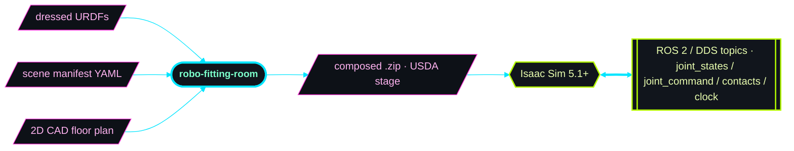

# robo-fitting-room

Pure-Rust scene composition engine for multi-robot industrial cells.
Takes a YAML manifest + dressed URDFs (from
[`urdf-robo-dresser`](../urdf-robo-dresser/)) + a 2D CAD floor plan,
emits a self-contained `.zip` with an inlined ASCII USDA stage ready
to load in Isaac Sim 5.1+ (its lights and render setup follow Isaac Sim 6.x).
One binary: a CLI for offline / scripted use, an in-binary REST server with a
2D scene-layout editor for interactive workflows, which also speaks MCP when an
MCP client spawns it, and a stdio transport for embedding.



No native USD, PhysX, or Python deps: the stage is written as USDA text.

## Install

```sh
# From the workspace root: its default member is the viewer, so name the package.
cargo build --release -p robo-fitting-room                                         # CLI + REST server and MCP + stdio
cargo build --release -p robo-fitting-room --no-default-features                   # CLI only
cargo build --release -p robo-fitting-room --no-default-features --features stdio  # CLI + stdio, no HTTP stack
```

The binary lands in the workspace's `target/release/`. Below, `<asset-root>` is
an asset tree holding `fitted-robots/` (manifests), `urdf-dressed-robots/`,
`urdf-fixture-collection/` and `floor-plans/`. In this workspace that tree is
`assets/catalogue/` (Factory OS keeps its scenes as `scenes/<name>/scene.yaml`,
their paths relative to that folder), and its `scenes/cube-weld-2r/scene.yaml` — two
`kr240r2900__sticktool` robots facing the `weld_cube` fixture — is a ready-made
example; `demo-cell.yaml`, `scene.yaml`, `arm__gripper`, `station_a` and
`cell-floor-plan.obj` below are illustrative names.

## Quick start — CLI

```sh
# Validate a manifest
robo-fitting-room validate <asset-root>/fitted-robots/demo-cell.yaml

# Compose the demo cell into a zip
robo-fitting-room compose \
    --manifest <asset-root>/fitted-robots/demo-cell.yaml \
    --output   /tmp/demo-cell.zip
```

In Isaac Sim, `unzip` and **File → Open** the `.usda` (named after the
manifest). Hit Play; the robots start in their home pose — every actuated
joint's initial state is authored, at rest on its drive target — and the ROS 2
topics `/<cell>/<robot>/…` start publishing ([`docs/ros2-windows.md`](docs/ros2-windows.md)).

The stage is self-contained and loads offline: it is lit by a replica of Kit's
Default light rig, the cell stands on a matte grey ground with its collider,
the floor plan is drawn on the ground, six locked cameras frame the cell, and
the render settings and mode are left to Isaac Sim ([`docs/usda.md`](docs/usda.md)).

A manifest places robots and fixtures in metres and degrees; per robot it can
add a pedestal, the tool's mass and an effective link density, and the floor
plan can name its footprint layers ([`docs/manifests.md`](docs/manifests.md)):

```yaml
name: "Demo Cell"
robots:
  - robot_id: "R1"
    dressed_urdf: "../urdf-dressed-robots/arm__gripper/arm__gripper.urdf"
    position: { x: 1.5, y: 1.0, z: 0.0 }
    orientation: { a: 90.0, b: 0.0, c: 0.0 }
    home_pose_deg: [0, -90, 90, 0, 45, 0]            # optional; degrees, metres on prismatic joints
    pedestal: { height_mm: 500 }                     # optional
    payload:                                         # optional; merged into the link carrying the tool
      mass_kg: 80                                    # required, > 0
      center_of_mass_m: { x: 0.0, y: 0.0, z: 0.25 }  # optional, tool link frame
      inertia_kgm2: { ixx: 4, iyy: 4, izz: 2 }       # optional, about the centre of mass
      link: tool0                                    # optional, a link of the URDF
    link_density_kg_m3: 1000                         # optional, > 0; default 1200
fixtures:
  - id: "station_a"
    urdf: "../urdf-fixture-collection/station_a/station_a.urdf"
    position: { x: 0.0, y: 1.0, z: 0.0 }
    orientation: { a: 0.0, b: 0.0, c: 0.0 }
floor_plan:
  geometry_file: "../floor-plans/cell-floor-plan.obj"
  footprint_layers: [ZONE_7]                         # optional
```

How the physics is derived — the initial joint state, the drives, the generic
mass model (URDF inertials unless placeholders, else the collision geometry at
the link density), the payload and the collision filtering — is in
[`docs/physics.md`](docs/physics.md).

### Also emit a URDF source bundle

Pass `--urdf-bundle` to write a **second** zip next to the USDA one: a
self-contained package of the scene's *source* files — every URDF's folder
copied byte-for-byte, the floor-plan OBJ, and the manifest with its asset
paths rewritten to them (every other key kept). Extract it anywhere and it
stands alone. The USDA output is unchanged.

```sh
# Compose a two-robot cell, USDA zip + URDF source bundle
robo-fitting-room compose \
    --manifest <asset-root>/fitted-robots/scene.yaml \
    --output   /tmp/two-robot-cell.zip \
    --urdf-bundle
```

The bundle path is derived from `--output` by inserting a `-urdf`
suffix, so this run produces two files in `/tmp/`:

```
two-robot-cell.zip        # USDA stage (inlined) + manifest
two-robot-cell-urdf.zip   # scene.yaml + robots/ + fixtures/ + floorplans/
```

Both robots in this scene share one dressed URDF, so the bundle
deduplicates them into a single `robots/arm__gripper/` folder. The bundle has
no top-level folder; extracted into `two-robot-cell-urdf/`:

```
two-robot-cell-urdf/
├── scene.yaml                                   # the manifest (named after it), paths rewritten: robots/… fixtures/… floorplans/…
├── robots/arm__gripper/                         # deduped robot (referenced by both R1 and R2)
│   ├── arm__gripper.urdf
│   └── meshes/{robot,tool,3dreach}/…            # 3dreach: the dresser's reach envelope, bundled but not read by compose
├── fixtures/station_a/
│   ├── station_a.urdf
│   └── meshes/…
└── floorplans/cell-floor-plan/
    └── cell-floor-plan.obj
```

In the 2D editor, the **Generate USDA** dialog exposes an equivalent
*"Also download URDF source bundle"* checkbox; over REST it's a
separate `POST /api/v1/compose-urdf-bundle?manifest_path=…` streaming
the bundle zip. Details: [`docs/cli.md`](docs/cli.md#the-urdf-source-bundle).

## Quick start — server + 2D editor

```sh
robo-fitting-room serve --asset-root <asset-root>
# open http://localhost:3040/        2D scene-layout editor
# open http://localhost:3040/docs    Swagger UI
```

Click robots and fixtures in the palette to add them, drag them into place
over the floor plan, set per-robot home poses in the inspector, and click
**Generate USDA**: the editor validates the scene, saves it under
`fitted-robots/` and downloads the composed zip. The editor's one dependency,
js-yaml, is vendored under `web/vendor/` and served by the binary, so the page
needs no internet access.

The editor has the palette on the left, the canvas with the floor plan
(footprint layers in orange) in the middle, and the inspector on the right,
which labels each home-pose field ° (turning joints) or m (sliding joints).

## Quick start — stdio

```sh
printf '%s\n' '{"id":1,"method":"health.check"}' | robo-fitting-room stdio-serve --asset-root <asset-root>
# {"id":1,"result":{"status":"ok","version":"<version>"}}
```

One JSON request per line in, one response per line out — every REST route as
a method, without a network port ([`docs/api.md`](docs/api.md#stdio-transport)).

## Quick start — MCP

```sh
claude mcp add robo-fitting-room -- \
    /path/to/robo-fitting-room serve --asset-root /path/to/asset-root --port 3041
```

Claude Code then spawns `serve` with stdin and stdout as its MCP channel: the 13
REST operations come up as tools (`mcp__robo-fitting-room__compose_scene`, …;
`compose_scene` saves the zip in a temporary folder and returns its path), and
the REST API and the editor run beside them on port 3041 until the session
ends. A `serve` started in a terminal has no MCP and behaves as before. The
tools, their results, the shutdown rules and a Kiro `mcp.json` entry:
[`docs/api.md`](docs/api.md#mcp-transport).

## Visual fidelity matrix

The compose pass has two independent fidelity flags that control which
mesh prims are emitted. Articulation behaviour is identical across all
combinations: every collision hull is always emitted, and the flags only add
visuals and decide which hulls are shown.

| `--full-robots` | `--full-tools` | Viewport | Zip size |
|---|---|---|---|
| false (default) | true (default) | Robot collision hulls (in the link's paint) + tool visuals | hulls + tool visuals |
| false | false | Robot + tool collision hulls only | smallest: hulls only |
| true | true | Full robot + full tool visuals | largest: hulls + every visual |
| true | false | Full robot visuals + tool hulls | hulls + robot visuals |

How large depends on the URDFs' meshes: each `compose` prints its inline mesh
count and zip size. Tool geometry is a mesh under `meshes/tool/` (any case,
either separator), as `urdf-robo-dresser` writes it, or — when those links have
no such mesh — all the geometry of a manifest's `payload.link` and the links
fixed below it.

## Documentation

- [`docs/cli.md`](docs/cli.md) — every subcommand with worked examples, the library API, tests
- [`docs/api.md`](docs/api.md) — REST API reference, curl recipes, the MCP and stdio transports, the editor
- [`docs/concepts.md`](docs/concepts.md) — manifest, dressed URDF, home pose and start state, articulation root, contact graphs, topic schema
- [`docs/manifests.md`](docs/manifests.md) — manifest schema reference, floor-plan rules, every validation error and warning
- [`docs/physics.md`](docs/physics.md) — initial joint state, drives, mass model, payload, collisions, PhysicsScene
- [`docs/usda.md`](docs/usda.md) — what gets emitted in the USDA + per-prim path table
- [`docs/ros2-windows.md`](docs/ros2-windows.md) — Pixi + DDS Windows walkthrough
- [`openapi.json`](openapi.json) — checked-in OpenAPI 3.x spec
- [REQUIREMENTS.md](REQUIREMENTS.md) — FR/NFR tracker, `tests/requirements.rs` is 1:1 with this file

## Status

What's shipped:

- Manifest parsing + validation, with warnings for what composes but probably not as meant (non-OBJ, URI or missing meshes; payload fallbacks; floor plans without lines or footprints, or not flat); multi-robot scene composition (FR-100, FR-101, FR-103)
- URDF → USD conversion with PhysX articulations (signed and skewed axes folded into the joint frames), FK home pose, OBJ meshes inlined, URDF box/cylinder/sphere primitives as UsdGeom prims, MTL colours linearised (FR-110..112, FR-116, FR-157)
- Physics start state and drives: every actuated joint starts at its home value at rest (`PhysicsJointStateAPI`; prismatic homes in metres), drives damped at ζ 0.7 on the composite inertia they move (a linear drive's stiffness from the mass it moves), finite force caps and the URDF velocity limits (FR-117, FR-118, FR-157, FR-158)
- One generic mass model: URDF inertials unless placeholders, else the collision geometry at an effective link density, frame links nearly massless; tool payloads merged into the tool link, or the manifest's `payload.link` (FR-113, FR-159)
- Fixtures as static colliders; pedestals; the welded base filtered against its own pedestal and the ground (FR-102, FR-119)
- PhysX scene tuning written to the `PhysxSceneAPI` schema (120 Hz, gravity −Z, iteration caps that keep the articulations' 64 / 4, GPU broadphase capacities ≥ PhysX's defaults) (FR-154..156)
- Per-robot ROS 2 ActionGraphs (joint state pub/sub, articulation controller) and per-link contact sensors → `std_msgs/Bool` topics, all under `/<cell>/<robot>/…` with a cell-scoped clock; Cyclone DDS conformance (FR-151..153, FR-160..162, FR-212)
- Scene globals: a six-camera rig under `/World/Cameras` (four isometric views, plan, elevation; Kit's exposure) framing the cell, with Kit's opening view seeded onto it; `framesPerSecond`, a `<name>: <description>` doc, `robo_fitting_room:*` provenance and model kinds in the layer (FR-108, FR-109)
- Environment, all inline (no FlatGrid; the stage loads offline): Kit's Default light rig replicated as stage lights, a matte mid-grey ground under the cell with its collider, the floor plan drawn on it as 2.5 cm strips (its footprint layers by name or the manifest's list), Isaac Sim's own render settings and mode (FR-105, FR-107, NFR-108)
- Deterministic USDA output; the URDF source bundle (FR-146..149, NFR-105)
- Versioned REST API at `/api/v1/*`, OpenAPI 3.x spec, healthz/readyz, path sandboxing; the stdio transport; manifest keys the tool doesn't know kept by save, load, the bundle and the editor (FR-181, FR-182, FR-188, FR-205..211)
- 2D scene-layout editor SPA embedded in the binary (FR-200, FR-202, FR-203)
- MCP beside the REST API: `serve`, spawned by an MCP client, offers every operation of the spec as a tool on stdin/stdout

What's planned (per [REQUIREMENTS.md](REQUIREMENTS.md)):

- `monitor` subcommand for collision fan-out (FR-164..169)
- Spatial validation: FK reach envelopes, static collision detection (FR-130..133)
- Isaac Sim live-deploy via Kit Remote (FR-170..177)
- STL/DAE meshes (BL-25), DXF floor plans (BL-22), a FollowJointTrajectory action server (BL-11)
- MuJoCo / Gazebo backends (BL-04 / BL-05)
