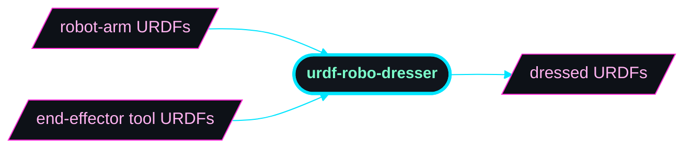
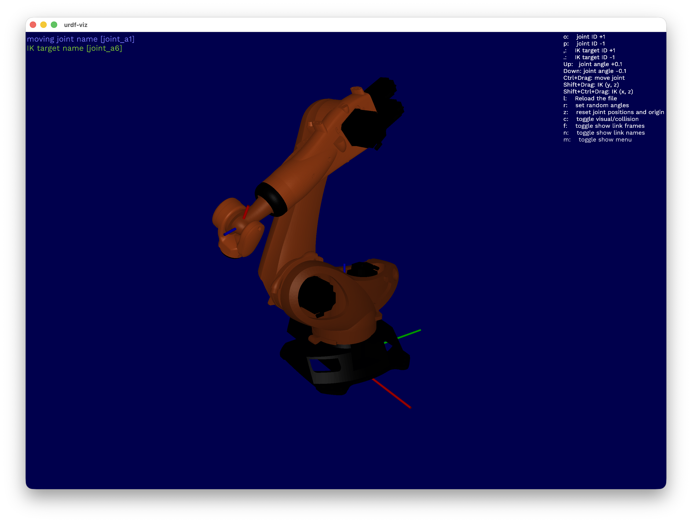

# urdf-robo-dresser

Programmatic URDF robot-tool merging for industrial automation. Takes a robot arm and an end-effector tool from a structured asset catalogue, automatically determines the mounting orientation, generates collision geometry, and produces a self-contained dressed URDF, with a fixed `tcp` frame at the tool's declared working point and a reach envelope, ready for simulation in Isaac Sim, RViz, or MoveIt.



---

## Quick Start

### Prerequisites

- Rust via rustup: https://rustup.rs. The workspace's `rust-toolchain.toml` pins the toolchain; rustup installs it on the first cargo command in the repo.
- urdf-viz, only for `dress --view`: `cargo install urdf-viz`

### Build

```sh
# From the workspace root: its default member is the viewer, so name the package.
cargo build --release -p urdf-robo-dresser                         # CLI + REST server and MCP
cargo build --release -p urdf-robo-dresser --no-default-features   # CLI only: no `serve`, no axum/tokio/utoipa
```

The binary lands in the workspace's `target/release/urdf-robo-dresser`. The examples below run from the workspace root, call it `urdf-robo-dresser`, and use the catalogue in `assets/catalogue/`.

In a fresh clone, run `scripts/fetch-rerun.sh` once first: cargo resolves the whole workspace, and the viewer and the backend depend by path on the rerun checkout in `third_party/rerun/src`, which is not committed. `factoryos-backend` and `robo-fitting-room` use this crate as a library, with `default-features = false`.

---

## Documentation

| File | What |
|------|------|
| [`docs/cli.md`](docs/cli.md) | Every subcommand (`dress`, `batch`, `validate`, `list`, `serve`) with worked examples, the library API, logging and tests |
| [`docs/api.md`](docs/api.md) | REST API: endpoints and operationIds, error envelope and codes, batch job lifecycle, path sandboxing, the MCP transport, the 3D viewer |
| [`docs/concepts.md`](docs/concepts.md) | Catalogue layout, flange detection and the `<axis>` default, the TCP, auto-orient algorithm, hull buffers, merge semantics, the reach envelope |
| [`openapi.json`](openapi.json) | Machine-readable wire schema (also served at `/openapi.json`) |
| [`REQUIREMENTS.md`](REQUIREMENTS.md) | FR/NFR tracker (each row links to the implementing source); `tests/requirements.rs` has one test per requirement |

---

## Example Walkthrough

### Step 1: Inspect the inputs



| Robot | Tool |
|-------|------|
| `urdf-viz assets/catalogue/urdf-robot-collection/kr240r2900/kr240r2900.urdf` | `urdf-viz assets/catalogue/urdf-tool-collection/sticktool/sticktool.urdf` |
| 6-DOF robot arm. The last joint defines the end-effector flange. | Origin (0,0,0) is the centre of the tool's docking interface; `sticktool` also declares a `tcp` link at its working point. |

### Step 2: Dress the robot

```sh
RUST_LOG=info urdf-robo-dresser dress \
  --robot  assets/catalogue/urdf-robot-collection/kr240r2900/kr240r2900.urdf \
  --tool   assets/catalogue/urdf-tool-collection/sticktool/sticktool.urdf \
  --output /tmp/kr240r2900__sticktool/kr240r2900__sticktool.urdf \
  --view
```

Output (the `INFO` lines go to stderr, the last two to stdout):

```
[… INFO  urdf_robo_dresser::collision] Generated 5 collision hulls for link 'World' (Medium)
[… INFO  urdf_robo_dresser::collision] Generated 1 collision hulls for link 'like_kr240r2900_base_link' (Medium)
… one such line each for like_kr240r2900_link_1 … like_kr240r2900_link_6
[… INFO  urdf_robo_dresser::merger] Auto-orient: loaded 5 mesh components into RAM
[… INFO  urdf_robo_dresser::merger] Auto-orient: picked [X, Y, Z] (normal_dot=…, centroid_outward=…, intersections=…)
Dressed URDF written to /tmp/kr240r2900__sticktool/kr240r2900__sticktool.urdf
Opening urdf-viz...
```

The tool orientation was determined automatically. The viewer opens immediately for inspection; `dress` returns when it is closed.

### Step 3: Inspect the result

| Visual Mode | Collision Hulls (press `c`) |
|-------------|----------------------------|
| Tool is merged into the end-effector link. All joints remain interactive. | Per-component convex hulls for both robot and tool. Medium buffer (5%). |

### Output Folder

The output is fully self-contained — all meshes are copied into the output directory:

```
/tmp/kr240r2900__sticktool/
├── kr240r2900__sticktool.urdf     # robot + tool (tool geometry on like_kr240r2900_link_6), tcp frame, <reach_envelope>
└── meshes/
    ├── robot/                     # robot visual meshes (+ .mtl), one convex hull per visual mesh
    │   ├── like_kr240r2900_*_visuals_*.obj
    │   ├── like_kr240r2900_*_hull_0.obj
    │   └── ...
    ├── tool/                      # tool visual meshes (+ .mtl), copied flat by file name
    │   ├── *.obj
    │   ├── World_hull_0.obj       # one convex hull per visual mesh of link World
    │   └── ... World_hull_4.obj
    └── 3dreach/
        └── reach_envelope.obj     # convex hull of the sampled tool-tip positions
```

The URDF starts with `<reach_envelope max_radius_2d="…" volume_3d="…" hull_mesh="./meshes/3dreach/reach_envelope.obj"/>`, a custom element like `<gazebo>`, and ends with the `tcp` link and its fixed `tcp_joint`. The robot's own collision meshes are not copied: the hulls replace them. Its `<robot name>` is `robot__tool`, because both inputs have an empty name. Use one folder per dressed robot: meshes already in a folder are not overwritten, but hulls are ([output layout](docs/cli.md#output-layout)).

---

## Commands

### `dress` — Merge a single robot with a tool

The core operation. Parses both URDFs, auto-detects the flange link, computes the tool orientation, generates collision hulls, and writes a single merged URDF with the tool's TCP frame and the reach envelope.

```sh
urdf-robo-dresser dress \
  --robot <ROBOT_URDF> \
  --tool <TOOL_URDF> \
  --output <OUTPUT_PATH> \
  [--orient <X,Y,Z>] \
  [--hull <tight|medium|max>] \
  [--attach-to <LINK_NAME>] \
  [--view]
```

**Flags:**

| Flag | Default | Description |
|------|---------|-------------|
| `--robot`, `--tool`, `--output` | required | The robot and tool URDFs, and the dressed URDF path; `meshes/` is written beside it (folders are created) |
| `--orient` | `0,0,0` (= auto) | Tool rotation in degrees, each 0/90/180/270, applied as URDF roll/pitch/yaw about the tool origin in the flange-link frame. `0,0,0` runs auto-orient, so the unrotated mount cannot be forced |
| `--hull` | `medium` | `tight` = the mesh's convex hull, `medium` = +5%, `max` = +15% (scaled about the mesh centroid) |
| `--attach-to` | auto | Flange link to mount on; it also carries the `tcp` frame. By default the deepest leaf link in the kinematic chain (ties by name) |
| `--view` | off | Run `urdf-viz <output>` (must be on PATH; a failed launch is ignored) and return when the viewer closes |

**What happens internally:**

1. Parse robot and tool URDFs into typed kinematic trees (a joint without `<axis>` gets the URDF default `1 0 0`)
2. Validate both: errors (no root or unreachable links, dangling refs, duplicate names) stop with exit 1; warnings (missing meshes, `lower >= upper`, visuals without collisions) are printed and dressing goes on
3. Generate one convex hull per visual mesh, tool first, then robot
4. Pick the flange link: `--attach-to`, else the deepest leaf link
5. Mount point: the flange face, the farthest point of the flange link's visual meshes along the axis of the joint driving it; the tool's origin goes there
6. Orientation: `--orient`, or auto-orient (64 candidates, 3-stage scoring) when it is `0,0,0`
7. Add the tool's visuals and collisions to the flange link, rotated and moved as one rigid group
8. Copy all mesh files (visuals + hulls, with their `.mtl`) into the output directory and rewrite their paths
9. Reach envelope: 10 samples per movable joint across its limits, FK to the tool tip → `meshes/3dreach/reach_envelope.obj` and `<reach_envelope>`
10. TCP: a fixed `tcp_joint` → `tcp` frame on the flange link at the tool's declared TCP (a warning in the log when it declares none)
11. Write deterministic output URDF

Exit codes, the diagnostics format and the output layout are in [`docs/cli.md`](docs/cli.md).

---

### `batch` — Generate all robot×tool combinations

Walks `<catalogue>/urdf-robot-collection/` × `urdf-tool-collection/` (each `<name>/<name>.urdf`) and dresses every pair. There is no validation step, and every pair uses auto-orient and automatic flange detection (no `--orient` / `--attach-to`). Failures are counted and skipped; the exit code is 1 when any pair failed.

```sh
urdf-robo-dresser batch \
  --catalogue <CATALOGUE_DIR> \
  --output <OUTPUT_DIR> \
  [--hull <tight|medium|max>]
```

**Expected catalogue structure:**

```
catalogue/
├── urdf-robot-collection/
│   ├── robot_a/
│   │   ├── robot_a.urdf
│   │   └── meshes/
│   └── robot_b/
│       ├── robot_b.urdf
│       └── meshes/
└── urdf-tool-collection/
    ├── TOOL_1/
    │   ├── TOOL_1.urdf
    │   └── meshes/
    └── TOOL_2/
        ├── TOOL_2.urdf
        └── meshes/
```

**Output:**

```
output/
├── robot_a__TOOL_1/
│   ├── robot_a__TOOL_1.urdf
│   └── meshes/
├── robot_a__TOOL_2/
│   ├── robot_a__TOOL_2.urdf
│   └── meshes/
├── robot_b__TOOL_1/
│   └── ...
└── robot_b__TOOL_2/
    └── ...
```

Each combination gets its own folder with a self-contained URDF and all meshes.

**Example:**

```sh
urdf-robo-dresser batch --catalogue assets/catalogue --output /tmp/all-dressed
```

```
Found 1 robot(s) and 1 tool(s)
  kr240r2900__sticktool -> /tmp/all-dressed/kr240r2900__sticktool/kr240r2900__sticktool.urdf

Batch complete: 1 success, 0 failed
```

With `RUST_LOG=info`, each pair's hull and auto-orient lines appear on stderr before that pair's line. Write into `assets/catalogue/urdf-dressed-robots/` only to rebuild the checked-in dressed robots.

---

### `validate` — Check a URDF for correctness

Runs structural validation without producing output. Useful for CI/CD or pre-flight checks.

```sh
urdf-robo-dresser validate <URDF_PATH> [--tool]
```

**Checks performed:**

- Joint `type` is revolute, continuous, prismatic, fixed, floating or planar (a parse error otherwise)
- `E014` (error): no duplicate link or joint names
- `E012` (error): every joint's parent and child link is declared
- `E011` (error): some link is a root (none means a cycle); with several roots, every link must be reachable from one
- `W013` (warning): `lower >= upper` in a revolute or prismatic joint's `<limit>`
- `W003` (warning): a referenced mesh file is missing (resolved against the URDF's folder)
- `W016` (warning): a link has visuals but no collisions (dressing generates hulls anyway)
- `--tool`: no extra check yet; the tool-origin check is a stub (FR-017)

**Example:**

```sh
urdf-robo-dresser validate assets/catalogue/urdf-robot-collection/kr240r2900/kr240r2900.urdf
# Valid URDF: 8 links, 7 joints

urdf-robo-dresser validate --tool assets/catalogue/urdf-tool-collection/sticktool/sticktool.urdf
# Valid URDF: 2 links, 1 joints
```

Diagnostics go to stderr as `error [E012] [<file>:joint 'j1']: …`. The exit code is 1 on a parse error or any error; warnings alone still print `Valid URDF: …` and exit 0.

---

### `list` — Show what a catalogue holds

```sh
urdf-robo-dresser list --catalogue assets/catalogue          # ROBOTS (1) / TOOLS (1) tables
urdf-robo-dresser list --catalogue assets/catalogue --json
```

```json
{
  "robots": [
    {"name": "kr240r2900", "flange": "like_kr240r2900_link_6", "joints": 7, "links": 8, "status": "valid"}
  ],
  "tools": [
    {"name": "sticktool", "visuals": 5, "status": "valid"}
  ]
}
```

`status` is `valid`, `incomplete` (validation errors or warnings) or `error` (the URDF does not parse). With neither robots nor tools, `list` prints `No assets found in <dir>` and exits 1. `GET /api/v1/catalogue` lists the same entries under its own field names.

---

### `serve` — 3D viewer SPA + REST API + Swagger UI

Boot the same operations as a versioned HTTP service, with a built-in
browser-based 3D URDF viewer at `/`.

```sh
urdf-robo-dresser serve --catalogue assets/catalogue     # [--port 3030] [--web-root crates/urdf-robo-dresser/web]
# 3D viewer + REST + Swagger UI on http://127.0.0.1:3030 (loopback only: forward the port to use it from another machine)
```

Open `http://localhost:3030/` in a browser: pick a robot and a tool from the
catalogue, click **Dress**, and preview the dressed robot in WebGL — orbit /
zoom / pan, step the tool orientation in 90° increments, and articulate the
joints with per-joint sliders or by dragging them in the viewport. The
**Dressed** list reloads earlier results, **Collision hulls** and **Reach
envelope** overlay the `<collision>` geometry and the reach hull, and
**Preload all** warms the browser cache with every robot, tool and dressed
robot. All 3D dependencies (three.js, urdf-loader) are vendored and served
locally — no CDN or network access at runtime. Every **Dress**, and every
±90° step, re-dresses through `POST /api/v1/dress`, so it writes into the
catalogue.

| Path | What |
|------|------|
| `/` | Built-in 3D viewer SPA (also served for unmatched paths) |
| `/assets/{*path}` | Raw catalogue files for the viewer (absolute paths and `..` rejected) |
| `/docs`, `/openapi.json` | Swagger UI, OpenAPI 3 spec |
| `/healthz`, `/readyz` | Liveness; readiness (503 while the catalogue has no robot and no tool) |
| `GET /api/v1/catalogue` (`/robots`, `/tools`) | Catalogue robots and tools |
| `GET /api/v1/catalogue/dressed` | Dressed robots: `[{name, urdf_rel}]` |
| `POST /api/v1/dress` | `{robot_id, tool_id, attach_to?, orient?: [x,y,z], hull?}`; writes `<catalogue>/urdf-dressed-robots/<robot_id>__<tool_id>/` and returns `{ok, dressed_urdf_rel, diagnostics}` |
| `POST /api/v1/validate` | `{path, tool?}` (catalogue-relative) → `{ok, diagnostics}` |
| `POST /api/v1/batch` | Every robot × tool → `202 {job_id, status_url}` |
| `GET /api/v1/jobs/{id}`, `/api/v1/jobs/{id}/artifact` | Poll the job; download its zip once `completed` |
| `GET /api/v1/preload`, `/api/v1/preload/{collection}/{name}` | The viewer's cache warm-up (not in the spec) |

Pass `--web-root <dir>` to serve the SPA from disk instead of the embedded
bundle (live-edit the viewer JS without rebuilding; development only, see
[`docs/cli.md`](docs/cli.md)).

```sh
curl -s http://localhost:3030/api/v1/catalogue | jq .

curl -s -X POST http://localhost:3030/api/v1/dress \
    -H "Content-Type: application/json" \
    -d '{"robot_id":"kr240r2900","tool_id":"sticktool","hull":"medium"}' \
    | jq .
# {"ok": true, "dressed_urdf_rel": "urdf-dressed-robots/kr240r2900__sticktool/kr240r2900__sticktool.urdf", "diagnostics": []}
```

Dressing over REST, like the viewer's **Dress** button, writes into the
served catalogue; here it rewrites the checked-in `kr240r2900__sticktool`. To
keep the tree clean, serve a copy (`cp -R assets/catalogue /tmp/catalogue`).

Both transports — CLI and REST — call the same library functions
(`parse_urdf` → `validate` → `generate_hulls` → `merge` → `serialize_urdf`).
They differ in where results go and in error reporting: REST `dress` writes
to `<catalogue>/urdf-dressed-robots/<robot_id>__<tool_id>/`, REST `batch`
builds a zip in the system temp directory and keeps its jobs in memory, and
REST errors come back as an HTTP status plus `{code, message, hint}`. See
[`docs/api.md`](docs/api.md) for the full REST reference.

### MCP — `serve` for agents and IDEs

```sh
claude mcp add urdf-robo-dresser -- \
  /path/to/urdf-robo-dresser serve --catalogue /path/to/catalogue --port 3031
```

Claude Code then spawns `serve` with stdin and stdout as its MCP channel: the
11 operations of the spec come up as tools (`mcp__urdf-robo-dresser__dress_robot`,
…), and the REST API and the viewer run beside them on port 3031 until the
session ends, sharing one state. A batch is `start_batch` → `get_job_status`
(poll) → `get_job_artifact`, which saves the zip in a temporary folder and
returns its path. A `serve` started in a terminal has no MCP and behaves as
before. The tools, their results, the shutdown rules and a Kiro `mcp.json`
entry: [`docs/api.md`](docs/api.md#mcp-transport).

---

## Auto-Orientation Algorithm

When `--orient` is not specified, the tool's mounting orientation is determined automatically using a purely geometric approach ([details](docs/concepts.md#auto-orientation-algorithm)):

### Stage 1: Direction Alignment

The tool's "pointing direction" (vector from origin 0,0,0 toward the mean of its visuals' `<origin>` positions) is compared against the robot's "flange outward direction": starting at `World`, or the first link, follow each link's first child joint to the end of the chain, accumulating the joint origins' rotations at home pose, and rotate that last joint's `<axis>` by them. A joint without `<axis>` uses the URDF default `1 0 0`.

For each of 64 candidate rotations (0°/90°/180°/270° on each axis), the tool direction is rotated and dotted with the flange outward vector. Higher dot product = better alignment.

### Stage 2: Centroid Outward Check

After rotation, the mean of the tool's mesh vertices should lie beyond the flange point along the flange outward direction (`centroid_outward = (centroid − flange point) · outward > 0`). This ensures the tool extends outward, not back into the arm.

### Stage 3: AABB Intersection

As a tiebreaker among near-equal candidates, the number of tool mesh vertices (in the flange-link frame) inside one axis-aligned box around all robot visual meshes, each placed by its `<visual>` origin only (link poses are not applied), is counted. Fewer intersections = better.

### Scoring

1. Sort candidates by highest `normal_dot` (direction alignment)
2. Among top candidates (within 0.05 of best), prefer those with `centroid_outward > 0`
3. Final tiebreak: lowest intersection count

---

## Collision Hull Generation

Every visual mesh component gets its own convex hull for collision detection. This produces tight-fitting collision geometry suitable for physics simulation.

### How it works

1. For each mesh `<visual>` of every robot and tool link (box, cylinder and sphere visuals get no hull), read its vertices: OBJ, or binary STL by extension; meshes with fewer than 4 vertices are skipped
2. Scale them about their centroid by the buffer factor (the mesh's own `scale` is not applied, so meshes must be in metres with scale 1)
3. Compute the convex hull using the quickhull algorithm (parry3d)
4. Write it to `meshes/{robot,tool}/<link>_hull_<n>.obj`, where `<n>` is the visual's index in its link
5. Replace the link's `<collision>` elements with these hulls (at the visuals' origins); links with no generated hull keep their collisions

### Buffer modes

| Mode | Scale Factor | Use Case |
|------|-------------|----------|
| `tight` | 1.0× | The mesh's convex hull, no inflation (concave regions are filled). |
| `medium` | 1.05× | 5% inflation. Default. Good balance for simulation. |
| `max` | 1.15× | 15% inflation. Generous margin for safety-critical scenarios. |

### Best practices

- Use `medium` (default) for general simulation and motion planning
- Use `tight` for the smallest hulls; they are still convex, so they are not a clearance-exact boundary
- Use `max` when planning safety zones or when mesh quality is low

---

## Tool URDF Requirements

For the auto-orient and merge to work correctly, tool URDFs must follow these conventions:

1. **Origin at docking center** — The URDF origin (0,0,0) must be located at the exact center of the tool's mounting flange interface. This is the point that connects to the robot's end-effector.

2. **Geometry relative to origin** — All visual and collision elements are positioned relative to this docking center using `<origin xyz="..." rpy="...">` attributes.

3. **Directory convention** — Each tool lives in its own directory named after the tool (this matters for `batch`, `list` and `serve`; `dress` takes any paths):
   ```
   TOOL_NAME/
   ├── TOOL_NAME.urdf
   └── meshes/
       ├── component_001.obj
       └── ...
   ```

4. **Mesh paths** — Mesh filenames in the URDF should be relative to the URDF file location (e.g. `./meshes/component.obj`); `package://` and `file://` URIs are not resolved.

5. **Tool centre point (TCP)** — Declare the working point as a link named `tcp` (or `<name>_tcp`, any case), reached from the tool's root link through fixed joints, its origin in the docking-interface frame:
   ```xml
   <link name="tcp"/>
   <joint name="tcp_joint" type="fixed">
     <origin xyz="0.67 0 0" rpy="0 0 0"/>
     <parent link="World"/>
     <child link="tcp"/>
   </joint>
   ```
   Dressing adds a `tcp` link and a fixed `tcp_joint` from the flange link at that point, with the tool's mounting offset and rotation applied (`tcp_2` / `tcp_joint_2`, … if the names are taken). A tool without one is dressed without a TCP frame and logs `tool '<name>' declares no tcp link: the dressed robot gets no TCP frame` (shown with `RUST_LOG=warn`).

6. **Geometry on the root link** — The dresser copies each tool element with its own `<origin>` only; the poses of other tool links are not applied (only the TCP is read through fixed joints).

7. **Metres, scale 1** — A mesh's `scale` attribute is ignored for hulls, auto-orient and the reach envelope.

8. **Unique mesh file names** — Meshes are copied flat into `meshes/tool/`; files with the same name collide, and the first one wins.

9. **Geometry on the working side** — Auto-orient points the tool from its origin toward the mean of its `<visual>` origins.

`validate --tool` does not check rule 1 yet (FR-017 is partial). More in [`docs/concepts.md`](docs/concepts.md#tool-urdf).

---

## Environment Variables

| Variable | Effect |
|----------|--------|
| (unset) | Errors only, and the dresser logs none: silent |
| `RUST_LOG=warn` | + warnings, e.g. `tool '<name>' declares no tcp link: the dressed robot gets no TCP frame` |
| `RUST_LOG=info` | + one line per hulled link, `Auto-orient: loaded …` / `picked …`, and `serve`'s listening address |
| `RUST_LOG=debug` | + the tool direction vector; applies to every crate, so use `RUST_LOG=urdf_robo_dresser=debug` to limit it to the dresser |

Logs go to stderr; results (`Dressed URDF written to …`, `Valid URDF: …`, `list`) and `serve`'s MCP messages go to stdout.

---

## Run Tests

```sh
cargo test -p urdf-robo-dresser                          # unit tests, tests/server.rs, OpenAPI snapshot
cargo test -p urdf-robo-dresser --no-default-features    # unit tests only (no server)
cargo test -p urdf-robo-dresser --test requirements      # FR/NFR spec: fails by design on its todo!()s
URD_UPDATE_SNAPSHOTS=1 cargo test -p urdf-robo-dresser --test openapi_snapshot   # refresh openapi.json
```

The unit tests cover validation, orientation parsing, the `<axis>` default, the TCP helpers, the reach envelope and mesh math; `tests/server.rs` covers the REST routes on a temporary catalogue. The parser and merge tests that need real URDFs look for `crates/assets/` and skip in this workspace ([`docs/cli.md`](docs/cli.md#testing)).
